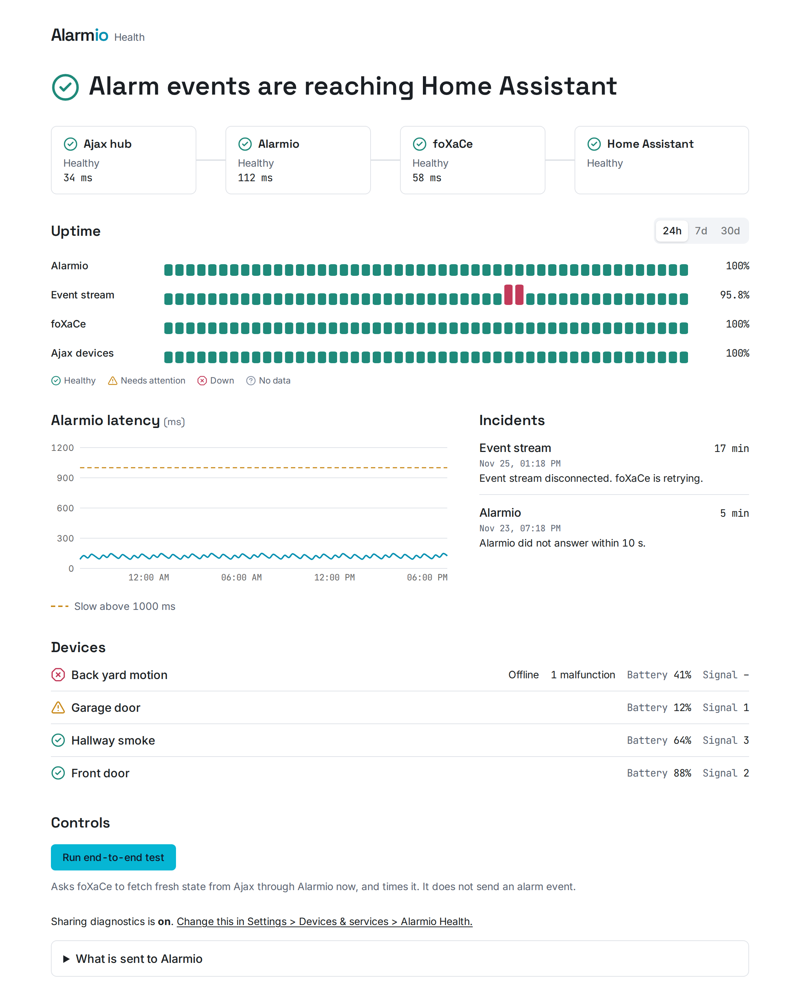
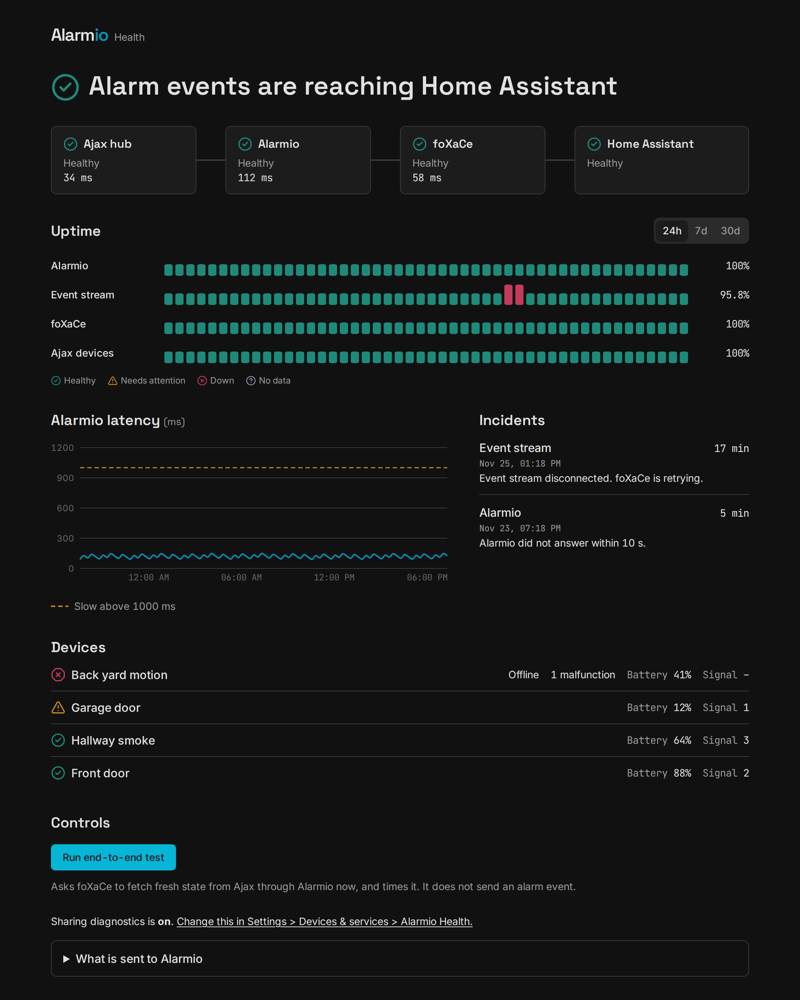
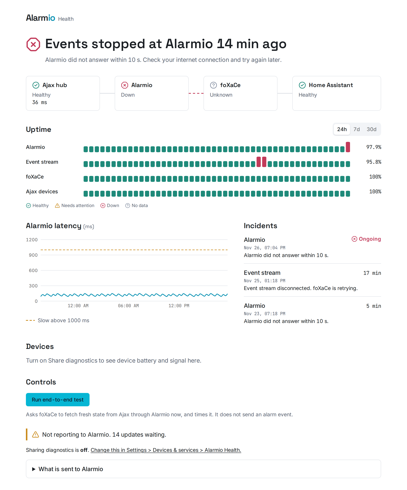
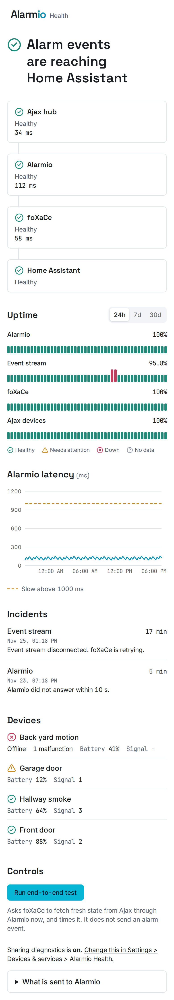

# Alarmio Health

Alarmio Health is a Home Assistant integration that answers one question: will an alarm event reach
Home Assistant right now? It checks each link in the chain (Ajax hub, Alarmio, the foXaCe integration,
Home Assistant), shows the answer in a sidebar panel, keeps a history of outages, and creates entities
you can use in automations and dashboards.

More screenshots (dark theme, an outage, phone)

*Screenshots use sample data.*

## Requirements

- Home Assistant 2025.x. The integration is tested against 2025.1.4.
- The foXaCe Ajax integration, v0.38 or v0.39, set up in **Alarmio proxy mode**.
- An Alarmio account. Alarmio Health reuses the session foXaCe already has and holds no credentials of its own.

## Install

HACS (custom repository):

1. In HACS, open the menu, choose **Custom repositories**, and add `https://github.com/alarmio/alarmio-health` as type **Integration**.
2. Install **Alarmio Health** and restart Home Assistant.

Manual: copy `custom_components/alarmio_health` into your Home Assistant `custom_components` folder and restart.

## Setup

**Settings > Devices & services > Add integration > Alarmio Health.** There is nothing to enter.

## What the checks do

Every 60 seconds the integration runs six checks:

| Check | What it looks at |
|---|---|
| Alarmio reachability | Whether Alarmio answers, and how fast |
| Alarmio certificate | Whether the TLS certificate is valid and not close to expiry |
| Alarmio session | Whether your session is still accepted, using the heartbeat |
| foXaCe integration | Whether foXaCe is loaded and working in proxy mode |
| Event stream | Whether foXaCe's event stream to Alarmio is connected |
| Ajax hub and devices | Hub online state and device health as foXaCe reports it |

An incident opens after 3 consecutive failures of a check and closes after 2 consecutive successes, so a
single blip does not raise an alarm. Incidents are kept for 90 days.

Limitations, stated plainly:

- **Keepalive age is not observable.** foXaCe discards keepalive messages, so this integration cannot tell how long ago the last one arrived.
- **Silence while the system is disarmed is never a failure.** Ajax only sends events when armed, so a quiet stream is normal then.
- **"Unknown" means we could not tell.** It is not a pass and not a fail.

## Privacy

The full privacy notice is in [PRIVACY.md](PRIVACY.md). This section lists exactly what is sent.

Once per check cycle the integration sends a heartbeat to Alarmio, authenticated with your existing
Alarmio session. If sending fails, heartbeats are queued (bounded) and the panel shows
"Not reporting to Alarmio". The payload carries `schema: 1`. Alarmio identifies you from the session token
on the request; the payload itself carries no subscriber ID.

| Tier | When | What is sent |
|---|---|---|
| Always on | Always | `schema`, `sent_at`, `integration_version`, and for each probe its name, status, latency and a short failure reason |
| Diagnostics | Only when **Share diagnostics with Alarmio** is on (off by default) | `reconnects`, `ha_version`, `foxace_version`, `proxy_mode`, `armed`, and the device list: device **names**, online flag, malfunction count, battery and signal. `devices_truncated` is added when the list had to be shortened |

A failure reason is free text such as "foXaCe 0.39.0 has not been tested with Alarmio Health" or
"2 offline, 1 low battery", so it can contain the foXaCe version and aggregate device counts even in the
always-on tier.

`armed` says whether your alarm is armed. Over time that reveals when your home is occupied, so it is only
sent when you opt in. The device list contains the names you gave your devices.

A heartbeat is capped at about 12 KiB. On large installations the device list is shortened worst first
(offline, then lowest battery, then lowest signal) and `devices_truncated` records how many were left out.

The diagnostics tier describes your home installation, so it is opt-in and POPIA applies to it. The panel
shows exactly what is being sent, under "What is sent to Alarmio".

## Entities

All entities belong to one service device, "Alarmio Health". Unique IDs are `<entry id>_<suffix>`.

| Suffix | Name | Type |
|---|---|---|
| `alarmio_status` | Alarmio reachability | sensor |
| `tls_status` | Alarmio certificate | sensor |
| `session_status` | Alarmio session | sensor |
| `foxace_status` | foXaCe integration | sensor |
| `stream_status` | Event stream | sensor |
| `ajax_status` | Ajax hub and devices | sensor |
| `alarmio_problem` | Alarmio reachability problem | binary sensor |
| `tls_problem` | Alarmio certificate problem | binary sensor |
| `session_problem` | Alarmio session problem | binary sensor |
| `foxace_problem` | foXaCe integration problem | binary sensor |
| `stream_problem` | Event stream problem | binary sensor |
| `ajax_problem` | Ajax hub and devices problem | binary sensor |
| `alarmio_latency` | Alarmio latency | sensor (ms) |
| `share_diagnostics` | Share diagnostics with Alarmio | switch |

## The panel

A sidebar item named **Alarmio Health** opens the panel:

- **Verdict:** one headline saying whether alarm events are reaching Home Assistant.
- **Signal chain:** Ajax hub, Alarmio, foXaCe, Home Assistant, with a gap drawn where the chain is broken. Status is always shown as text and an icon, never colour alone.
- **Uptime strips:** per-check history over 24h, 7d or 30d.
- **Alarmio latency:** a chart over the same range, with a marker at 1000 ms. The figure includes TCP and TLS connection setup (checks are a minute apart, so the connection is not reused), so about 500 ms is normal from many homes. Alarmio is reported as "needs attention" only after two slow readings in a row; one slow reading shows on the chart but does not change the status. An outage is never delayed.
- **Incidents:** open and closed incidents.
- **Devices:** the diagnostics that would be shared, when sharing is on.
- **Controls:** the **Run end-to-end test** button, the sharing state, and the "What is sent to Alarmio" disclosure. The test is read-only (it does not arm, disarm or change anything) and is rate-limited to once per 30 seconds; a repeat press within that time shows the previous result.

## Development

Python:

    python3 -m venv venv
    venv/bin/pip install -r requirements-dev.txt
    venv/bin/pytest -q
    venv/bin/ruff check custom_components tests --exclude tests/fixtures

Frontend (in `frontend/`):

    npm --prefix frontend install
    npm --prefix frontend test            # unit tests
    npm --prefix frontend run test:ci     # builds the panel first, then also checks the built bundle
    npm --prefix frontend run typecheck
    npm --prefix frontend run e2e         # Playwright, real Chromium; see frontend/e2e/README.md
    npm --prefix frontend run dev         # dev harness, e.g. /?mock=down&theme=dark

Playwright's Chromium needs system libraries. If they are not installed, point `LD_LIBRARY_PATH` at an
extracted copy (details in `frontend/e2e/README.md`).

HACS installs the repository as is and does not run a build, so the built panel is committed in
`custom_components/alarmio_health/www/`. Rebuild it after any change in `frontend/`:

    npm --prefix frontend run build

## Credits

The panel bundles three fonts, served locally with no CDN, all under the SIL Open Font License 1.1:
Space Grotesk, Inter and JetBrains Mono. See `custom_components/alarmio_health/www/fonts/LICENSES.md`.

## Licence

MIT, see `LICENSE`. The bundled fonts (Space Grotesk, Inter, JetBrains Mono) are under the SIL Open Font License; see `custom_components/alarmio_health/www/fonts/LICENSES.md`. Test fixtures copied from foXaCe's integration (MIT) are in `tests/fixtures/foxace-0.39.0/` with their licence.
